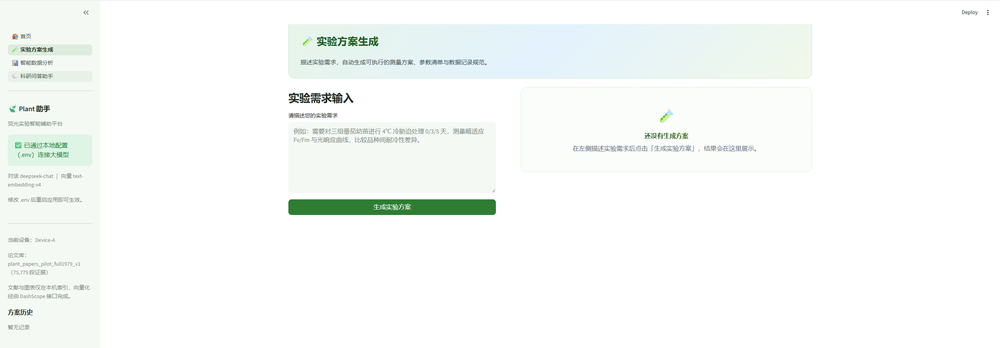
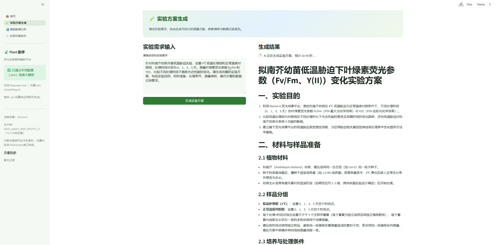
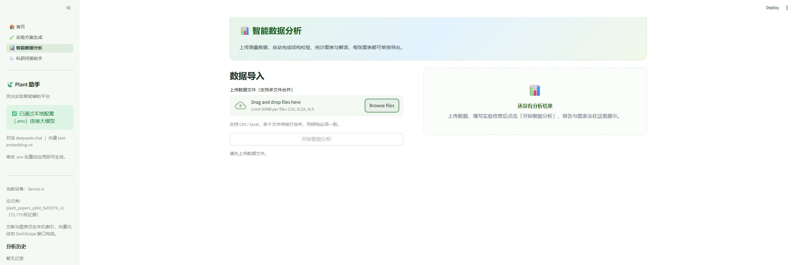
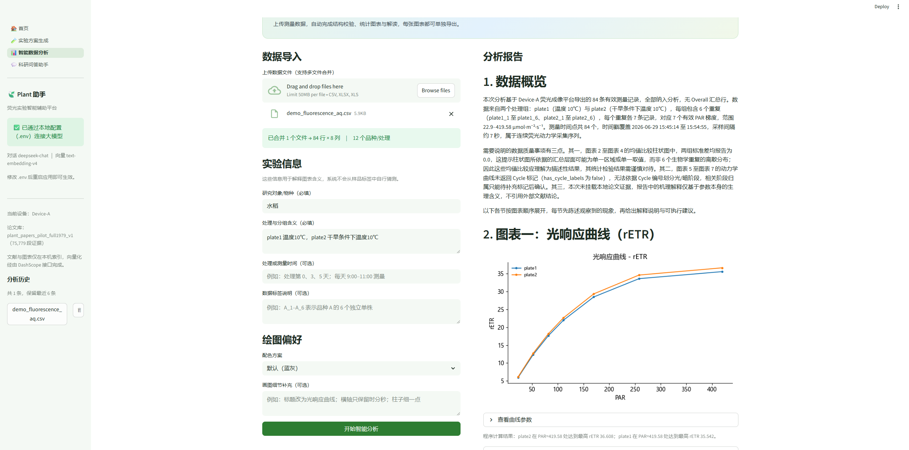
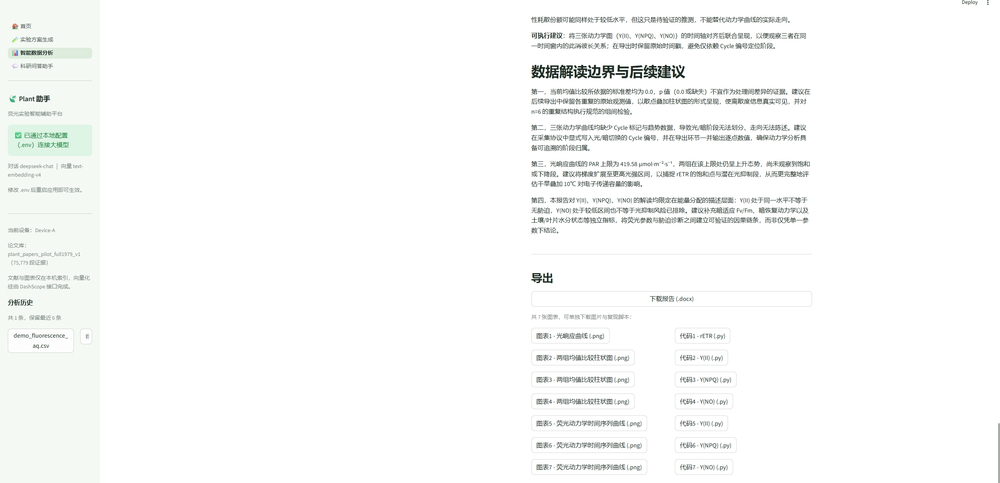
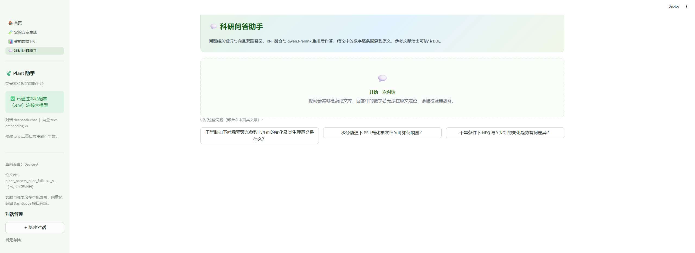
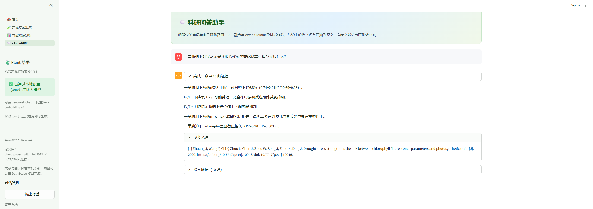

https://github.com/user-attachments/assets/fc55a0d5-cb3b-48aa-9863-ef75d933a348
# Plant-AI Demo｜叶绿素荧光科研辅助系统

基于 Python、RAG 与 LLM
工作流开发的科研辅助应用，面向叶绿素荧光相关科研场景，提供实验方案生成、数据分析和科研问答三个功能模块。

项目从实际科研需求出发，将文献检索、实验数据处理与大模型能力结合，帮助科研人员完成日常科研辅助工作。

## 一、项目功能

### 1. 实验方案生成

根据用户输入的实验对象、胁迫条件和测量指标，结合提示词约束调用大模型生成结构化实验方案。

-   支持实验目的、材料准备、仪器参数、操作步骤等内容生成。
-   按照固定章节组织输出。
-   支持 Word 文档导出。
-   对不确定的设备参数进行约束，避免随意生成具体数值。

**实现方式：** Prompt 组织 + LLM 生成 + 流式输出。

**界面截图：**


https://github.com/user-attachments/assets/83a042ee-a4f5-4c9d-b6ed-76cca898ade1


https://github.com/user-attachments/assets/7a301763-620c-4488-93fd-7396696ae24f


https://github.com/user-attachments/assets/0f14d94a-8fbb-4f00-895c-b599a8a34096






> 说明：当前模块采用提示词生成方式，不经过论文向量检索，参考来源不具备DOI 级自动溯源能力。

### 2. 智能数据分析

针对叶绿素荧光实验数据，提供从 CSV 上传到分析报告生成的处理流程。

-   支持 CSV 数据上传及多文件合并。
-   根据数据结构和实验分组识别分析类型。
-   使用 Python 完成统计计算和图表生成。
-   将程序计算结果交给大模型进行分析和报告撰写。
-   支持 Word 报告、PNG 图表及 Python 复现脚本导出。

**核心设计：**
将数值计算与大模型文本解读分离，统计结果由代码计算产生，模型负责结合已有结果进行解释，降低模型直接生成错误统计数值的风险。

**界面截图：**









### 3. 科研问答助手

基于 RAG
构建科研文献问答功能，支持围绕叶绿素荧光参数、植物胁迫响应等问题进行检索与回答。

核心检索流程：

1.  使用 ChromaDB 进行向量检索。
2.  使用 BM25 进行关键词检索。
3.  通过 RRF 融合两路检索结果。
4.  使用 Qwen Reranker 对候选文献进行重排序。
5.  调用 DeepSeek 结合检索证据生成回答。
6.  对回答中的数值进行原文证据校验，并关联 DOI 参考文献。

同时结合物种、胁迫类型等条件进行检索约束，减少不相关文献对回答的干扰。

**核心设计：**
回答尽量基于检索到的文献证据生成，缺少有效证据时限制回答，降低模型幻觉带来的影响。

**界面截图：**





## 二、技术架构

### 主要技术栈

  类型         技术
------------ ----------------------
  开发语言     Python
  前端界面     Streamlit
  大模型应用   LangChain、LangGraph
  大模型服务   DeepSeek
  向量数据库   ChromaDB
  关键词检索   BM25
  检索排序     RRF、Qwen Reranker
  数据处理     Pandas、NumPy、SciPy
  图表生成     Matplotlib

### 核心技术实现

**1. RAG 混合检索**

结合向量检索和关键词检索，兼顾语义相关性与专业术语匹配，再通过 RRF
融合和 Reranker 重排序，提高候选文献的相关性。

**2. 工作流编排**

使用 LangGraph
组织数据分析流程，将数据处理、统计计算、图表生成和报告生成拆分为不同节点，通过状态传递组织各环节执行。

**3. 数值校验与引用追溯**

针对大模型可能生成不存在的统计数值的问题，将程序计算结果与模型文本解读分离；在科研问答中结合证据
ID、原文数值校验和 DOI 信息，实现回答的证据追溯。

**4. 工程测试与异常处理**

针对向量数据库加载、文件路径等问题进行排查和修复，并通过单元测试验证相关功能。

## 三、项目运行

### 1. 环境要求

-   Python 3.10+
-   DeepSeek API Key
-   阿里云 DashScope API Key

### 2. 获取项目

``` bash
git clone https://github.com/Zzz-amaz/plant-ai-rag-demo.git

cd plant-ai-rag-demo
```

### 3. 安装依赖

``` bash
python -m venv .venv
```

Windows PowerShell：

``` powershell
.\.venv\Scripts\Activate.ps1
```

安装依赖：

``` bash
pip install -r requirements.txt
```

### 4. 配置环境变量

复制 `.env.example` 并创建 `.env` 文件，填写对应 API Key：

``` env
LLM_API_KEY=你的DeepSeek_API_Key
EMBEDDING_API_KEY=你的DashScope_API_Key
```

注意：不要将个人 API Key 提交到 GitHub。

### 5. 启动项目

``` bash
streamlit run app.py
```

启动成功后访问：

``` text
http://localhost:8501
```

### 6. 功能运行说明

-----------------------------------------------------------------------
  功能模块                            运行条件
----------------------------------- -----------------------------------
  实验方案生成                        配置 LLM API Key

  智能数据分析                        配置 LLM API Key，使用项目样例 CSV

  科研问答助手                        需要额外准备本地论文向量库及 BM25
                                      检索语料，并配置 Embedding API Key
  -----------------------------------------------------------------------

**数据资源说明：**

论文向量库及相关检索语料体积较大，未上传至 GitHub，已通过 `.gitignore`
排除。因此，克隆仓库后可以获取项目代码和样例数据，但不能直接运行完整的论文检索链路。

项目自带的 `examples/` 目录包含两份 CSV
样例，可用于体验智能数据分析功能。

## 四、项目结构

``` text
plant-ai-rag-demo/
│
├── agents/          # LangGraph 工作流及模型客户端
├── core/            # 配置与日志
├── devices/         # 设备手册及操作规范
├── evaluation/      # 检索相关模块
├── examples/        # CSV 样例数据
├── rag/             # RAG 检索、排序与引用校验
├── services/        # 业务服务与文档导出
├── ui/              # 界面组件
├── views/           # 三个主要功能页面
│
├── app.py           # Streamlit 应用入口
├── example_run.py   # 检索链路示例
├── requirements.txt # 项目依赖
└── README.md
```

## 五、项目说明

-   本项目为个人整理的无敏展示版本，保留主要业务流程和技术实现。
-   论文语料为公开文献，未将本地大型向量数据库及完整检索语料上传至仓库。
-   设备相关文档中的企业标识、设备型号及内部路径已进行中性化处理。
-   实验方案生成、数据分析和科研问答采用不同的业务处理流程，不能将三个模块的检索与引用能力混为一谈。

## 六、项目地址

GitHub：https://github.com/Zzz-amaz/plant-ai-rag-demo
